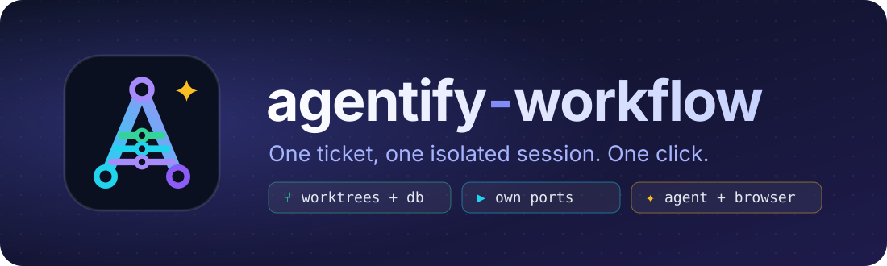

<p align="center">
  
</p>

<p align="center">
  <a href="LICENSE"></a>
  
  
  
  
</p>

<p align="center">
  <b>A desktop workspace for working on tickets that span many repositories with a coding agent.</b><br>
  Every ticket is a <i>session</i>: its own worktrees, its own database, its own ports, the agent, a browser and the diff — in one window.
</p>

---

## Why

Working with coding agents across several repos usually means a terminal per repo, worktrees piling
up in random folders, two dev servers fighting for port 8000, a shared database that one branch's
migrations break for every other branch, and deleting a worktree that silently follows a
`node_modules` junction and empties the original.

`agentify-workflow` turns all of that into one card per ticket.

## What a session gives you

| | |
|---|---|
| **Worktrees** | One per repo the ticket touches, from a fresh `origin/<trunk>` (or the ticket's existing branch). |
| **Database** | A clone of a *golden* database — empty, migrated from zero and seeded once — taken in about a second. Branch migrations only run when the branch adds them. |
| **Ports** | A private block per session, so any number of sessions run side by side. |
| **Agent** | Claude Code, Codex, Gemini or opencode in a real terminal inside the app. Resumes the conversation when you come back. |
| **Probar** | One button boots the whole stack: repos in the ticket run from its branch, the rest from a fresh trunk copy, each through a small `run.sh`. |
| **Browser** | An embedded browser on the session's app, with region and full-page screenshots copied straight to the clipboard. |
| **Diff** | What is not committed yet, per repo, collapsible, unified or side by side — plus **Commit and push** (never to protected branches). |
| **Rebase** | **Actualizar con main** rebases every repo onto its trunk. Conflicts show up side by side in the app: pick main, your branch or both per block, or hand the files to the agent, then continue. A rewritten branch is pushed with `--force-with-lease`. |
| **API** | Try a backend with no front: the agent reads the repo and lists every endpoint with an example payload; log in once with a test user and send any call, see status, time and body, or copy it as curl. Any repo of the folder can be brought up in the running session. |
| **Delete** | Asks first, then shows each step — servers and agent stopped, worktrees, branches, databases — with its time until the session is gone. Anything that appears after you confirmed pauses it; a failed delete can be retried. |

## Highlights

- **Fast.** Measured on a real Django + React project: creating a session ~8 s, its database ~1 s, the full stack up in ~10 s.
- **Generated start scripts.** Add a repo from the **Repos** tab and the agent reads it and writes its `run.sh` / `stop.sh` / config; you review and save.
- **Connectors tab.** Git, GitHub CLI, Docker, PostgreSQL, each agent CLI and your ticket source, with a one-click fix for whatever is missing.
- **Tickets from Linear, GitHub Issues or by hand.** Choose the source in Connectors. Pick a ticket from your list and the repos it names (a `**Repos:**` line) are preselected; GitHub issues preselect the repo they live in. Blocked, in-progress and in-review tickets cannot be picked, and a blocked one says which ticket it waits for.
- **Tablero: your Linear board, live.** Your assigned tickets in your team's workflow columns (done ones for the last 14 days), read again every 30 s and whenever the window comes back. A ticket a bot works shows its avatar and its desk light; open a card to read it, start a session from it, assign it to a bot or open it in Linear. Drag a card to another column to change its state in Linear. Sub-tickets name their parent and epics count their done children; the drawer goes from parent to child and back, also to tickets assigned to someone else. Shown when Linear is the ticket provider.
- **Artifacts ↗.** One click opens your Claude Code artifacts on claude.ai in your browser, where you are already signed in.
- **The Office: bots in the cloud.** Claude Code routines that work tickets in their own sandbox, several at once. Assign a ticket, and each desk shows the bot's avatar, a bubble with where it stands and a light — working, done (the PR's ready check passed) or needs you (it asked something; answer from the desk). While the app is open it watches their PRs and asks for one iteration at a time when CI or the review turns red. Several bots can share one ticket label and tell themselves apart by their comment prefix: each ticket sits at the desk of the bot that last worked it.
- **Write tickets with the agent.** **+ Nuevo ticket** takes a few lines of context and has your agent create the ticket in Linear or GitHub Issues. Set `ticketPrompt` (e.g. `/my-team:ticket {context}`) to use your team's own ticket skill.
- **Knows when it is stale.** The top bar shows the version and commit the app started from, and warns when a newer commit is on disk and the app needs a restart.
- **Mock data for every model.** `examples/django-vite/repos/api/seed_all_models.py` fills a few rows of every Django model of your project, with signals muted so nothing reaches queues or mail.
- **Safe by default.** Links are removed before folders, protected branches are never pushed, the source database is never written.

## Install

```bash
npm install
npm run dist      # → dist/Agentify-Setup-<version>.exe
```

Or run from source with `npm run dev`.

## Configure

Pick the folder that holds your repos. The app writes `agentify.config.json` there with the repos
and agents it finds. Each repo can declare:

```jsonc
{
  "name": "api",
  "trunk": "main",
  "copyFiles": [".env"],                 // gitignored files a fresh worktree needs
  "linkDirs": [".venv"],                 // heavy folders shared instead of reinstalled
  "db": { "source": "empty", "seed": ["…"], "migrationPaths": [":(glob)**/migrations/*.py"], "…": "…" },
  "setup": ["uv run --no-sync python manage.py migrate --noinput"],
  "run": { "script": ".agentify/repos/api/run.sh", "port": true, "needs": [] }
}
```

`run.sh` receives `AGENTIFY_PORT`, `AGENTIFY_PORT_<OTHER_REPO>`, `AGENTIFY_DB_NAME` and
`AGENTIFY_SESSION`. A complete Django + Vite setup lives in [`examples/django-vite`](examples/django-vite).

Optional `startPrompt` sends a first message to the agent in every new session, e.g.
`"/work {ticket}"`.

## Develop

```bash
npm test          # unit + integration tests (real git repos in temp folders)
npm run e2e       # drives the built app end to end with Playwright
```

## License

[MIT](LICENSE)
